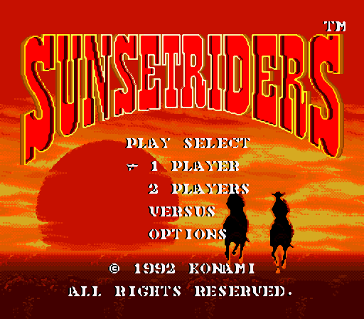
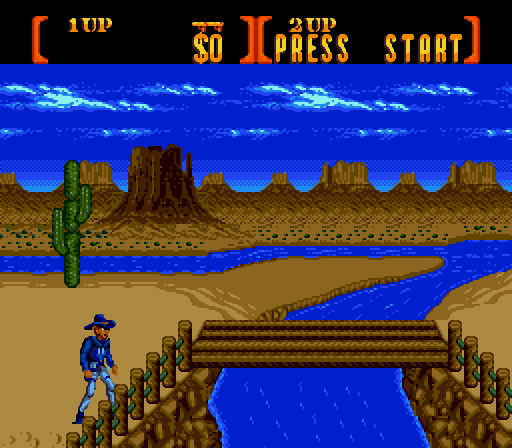
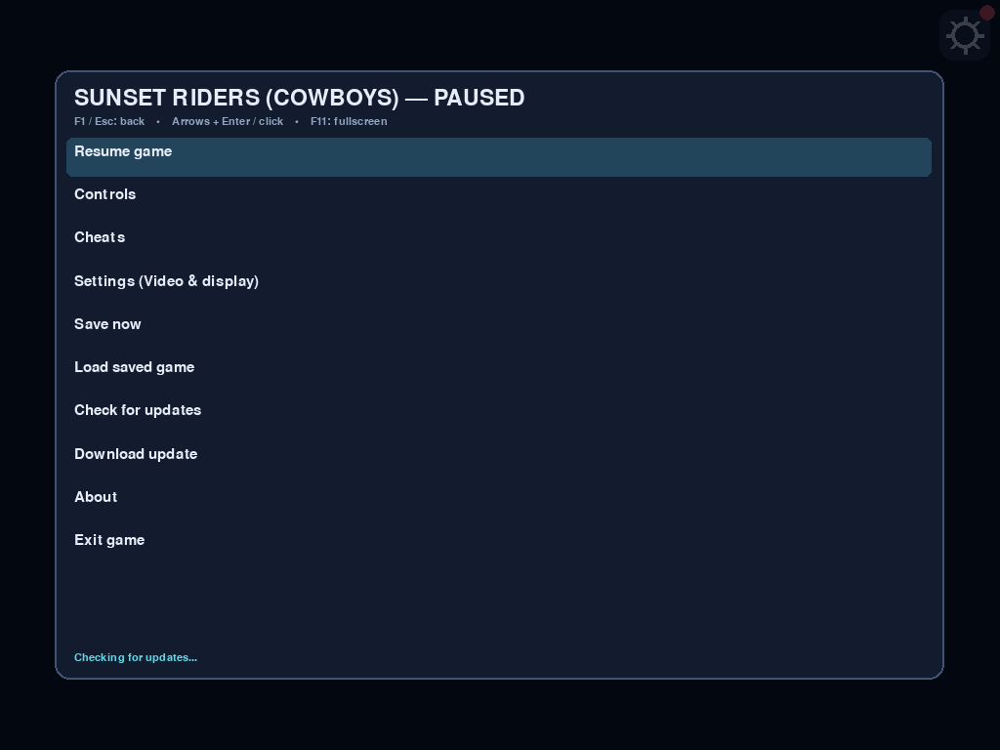

# 🤠 رعاة البقر — Sunset Riders (Sega Genesis / Mega Drive)

مستودع مخصّص بالكامل للعبة **رعاة البقر (`Sunset Riders (U) [!].bin`)** كـتطبيق مستقل بالكامل (Standalone Offline App) يعمل بدون الحاجة لأي ملفات خارجية على **Android** و **Windows** و **Linux** و **macOS**.

<p align="center">
  
</p>

---

## 📥 روابط التحميل المباشرة (Direct Download Links)

| المنصة (Platform) | صيغة الملف | رابط التحميل المباشر (Direct Download) | صفحة الإصدار (Release) | الحجم | SHA-256 Checksum |
| :--- | :--- | :--- | :--- | :--- | :--- |
| **Android** (ARM64 + ARMv7 + x86_64) | `.apk` | [**تحميل Sunset-Riders-1.0.apk**](https://github.com/midoali250/bitvault-engine/releases/download/sunset-riders-v1.0/Sunset-Riders-1.0.apk) | [`sunset-riders-v1.0`](https://github.com/midoali250/bitvault-engine/releases/tag/sunset-riders-v1.0) | 19.17 MB (`20,099,635` B) | `98ed96426e6eb2c80a24b0ee7d9bdb47cc6a736241699aa3346e236e44ecffe3` |
| **Windows** (x64 Portable) | `.exe` | [**تحميل Sunset-Riders-Windows-x64.exe**](https://github.com/midoali250/bitvault-engine/releases/download/sunset-riders-desktop-v1.0.0/Sunset-Riders-Windows-x64.exe) | [`sunset-riders-desktop-v1.0.0`](https://github.com/midoali250/bitvault-engine/releases/tag/sunset-riders-desktop-v1.0.0) | 16.75 MB (`17,558,819` B) | `e4a0708ba2b94876b748360be3838b594a04995ce5c458a8c1491575fe9b1717` |
| **Linux** (x86_64 AppImage) | `.AppImage` | [**تحميل Sunset-Riders-Linux-x86_64.AppImage**](https://github.com/midoali250/bitvault-engine/releases/download/sunset-riders-desktop-v1.0.0/Sunset-Riders-Linux-x86_64.AppImage) | [`sunset-riders-desktop-v1.0.0`](https://github.com/midoali250/bitvault-engine/releases/tag/sunset-riders-desktop-v1.0.0) | 26.81 MB (`28,113,400` B) | `7c4189c7f467bf4d2cd76c5e58e5d687d6ef63fecbaa45316bcf2366657c2803` |
| **macOS** (Apple Silicon `arm64`) | `.zip` (`.app`) | [**تحميل Sunset-Riders-macOS-arm64.zip**](https://github.com/midoali250/bitvault-engine/releases/download/sunset-riders-desktop-v1.0.0/Sunset-Riders-macOS-arm64.zip) | [`sunset-riders-desktop-v1.0.0`](https://github.com/midoali250/bitvault-engine/releases/tag/sunset-riders-desktop-v1.0.0) | 17.04 MB (`17,863,487` B) | `e205ce205dfcb9a26adac3ffaf764dc16a8b7fdd39696944ed7aae6f8d1754e6` |

---

## ✨ المميزات والتحسينات (Features)

1. **تشغيل فوري بدون إعدادات (Zero-Setup Offline Embedded ROM)**:
   - ملف اللعبة الأصلي `Sunset Riders (U) [!].bin` مدمج داخل التطبيق ويعمل مباشرة بسرعة 60 إطار/ثانية مع صوت Yamaha YM2612 FM + SN76489 PSG كامل عبر نواة `Genesis-Plus-GX` الأصلية (C/JNI).
2. **تحسين جودة الصورة والشاشة العريضة (2x HQ Scale2x + Genesis De-Dither + Widescreen)**:
   - معالج رسومي مدمج في النواة يزيل تشبيك الألوان العمودي (Horizontal Chroma De-Dithering) مع مضاعفة الدقة بخوارزمية **EPX / Scale2x** (`640×448`) وإمكانية التبديل بين ملء الشاشة الكامل (**Fill Screen Widescreen**) والأبعاد الأصلية (**4:3 Aspect**).
3. **عصا تحكم افتراضية حرة 360 درجة (Free-Floating 360° Analog Virtual Stick)**:
   - على أندرويد، تظهر عصا التحكم في أي مكان تلمسه في النصف الأيسر من الشاشة وتتحرك مع إصبعك بزاوية 360 درجة (8 اتجاهات دقيقة للقفز والتزحلق والتصويب القطري) مع إمكانية التبديل إلى أسهم D-Pad الكلاسيكية وتعديل الشفافية والحجم.
4. **قائمة شفرات مدمجة بالكامل (Built-in Cheats Menu)**:
   - **أرواح لا نهائية — لاعب 1 (`Infinite Lives P1`)** (`$FFCA35 = 9`)
   - **أرواح لا نهائية — لاعب 2 (`Infinite Lives P2`)** (`$FFCA75 = 9`)
   - **درع وحصانة دائمة ضد الرصاص (`Invincibility P1`)** (`$FFC316 = 0x50`)
   - **أقصى قوة نيران: مسدسان مزدوجان + طلق سريع (`Max Firepower: Dual Guns + Rapid Fire`)** (`$FFCA42 = 0x03`)
   - **محاولات لا نهائية + 99 عملة (`Infinite Credits & Continues`)** (`$FFCA03 = 9, $FFCA10 = 99`)
   - **قتل الزعماء بطلقة واحدة (`One-Hit Kill Bosses`)** (`$FFCEF9 = 1`)
5. **زر About داخل قائمة الإعدادات (Settings → About)**:
   - يعرض رسالة الإهداء الرسمية مع اسم **Ahmed Kamal Elgandy** بالخط العريض:
     > This game was developed by **Ahmed Kamal Elgandy**, who transferred it from old gaming devices to work across all modern platforms — Android, Windows, Linux, and macOS — out of love for retro games and to keep our childhood memories alive anytime, anywhere.

---

## 📸 لقطات شاشة من اللعبة (Screenshots)

<p align="center">
  
  
  
</p>

---

## 🗂️ هيكل المستودع (Repository Structure)

يحتوي هذا المستودع على ملفات لعبة **رعاة البقر (`Sunset Riders`)** فقط:

```text
├── games/sunset-riders/                 # مشروع أندرويد الكامل (Android APK + Genesis-Plus-GX JNI + Scale2x)
├── desktop/sunset-riders/               # تطبيق سطح المكتب لـ Windows و Linux و macOS (PySide6 + Genesis-Plus-GX C Core)
├── desktop/vendor/                      # تبعيات بناء سطح المكتب المشتركة
├── RELEASE-ARCHIVE/                     # أرشيف الإصدارات وملفات SHA256SUMS.txt
│   ├── Android/Sunset-Riders/1.0/
│   ├── Windows/Sunset-Riders/1.0.0/
│   ├── Linux/Sunset-Riders/1.0.0/
│   └── macOS/Sunset-Riders/1.0.0/
├── updates/
│   ├── games/sunset-riders.json         # ملف التحديث التلقائي لأندرويد (OTA Manifest)
│   ├── desktop/sunset-riders.json       # ملف التحديث التلقائي لسطح المكتب
│   └── client/android/                  # عميل التحديث التلقائي لأندرويد
├── tools/
│   ├── publish_sunset_riders.py         # أداة حساب SHA-256 وتحديث ملفات الإصدار
│   ├── validate_updates.py              # أداة التحقق من صحة روابط التحديث
│   └── naming/audit.py                  # أداة فحص جودة المستودع
└── .github/workflows/
    ├── sunset-riders.yml                # خط بناء ونشر تلقائي لـ Android و Windows و Linux و macOS
    ├── validate-updates.yml             # فحص ملفات التحديث
    └── naming-audit.yml                 # فحص التسمية
```
