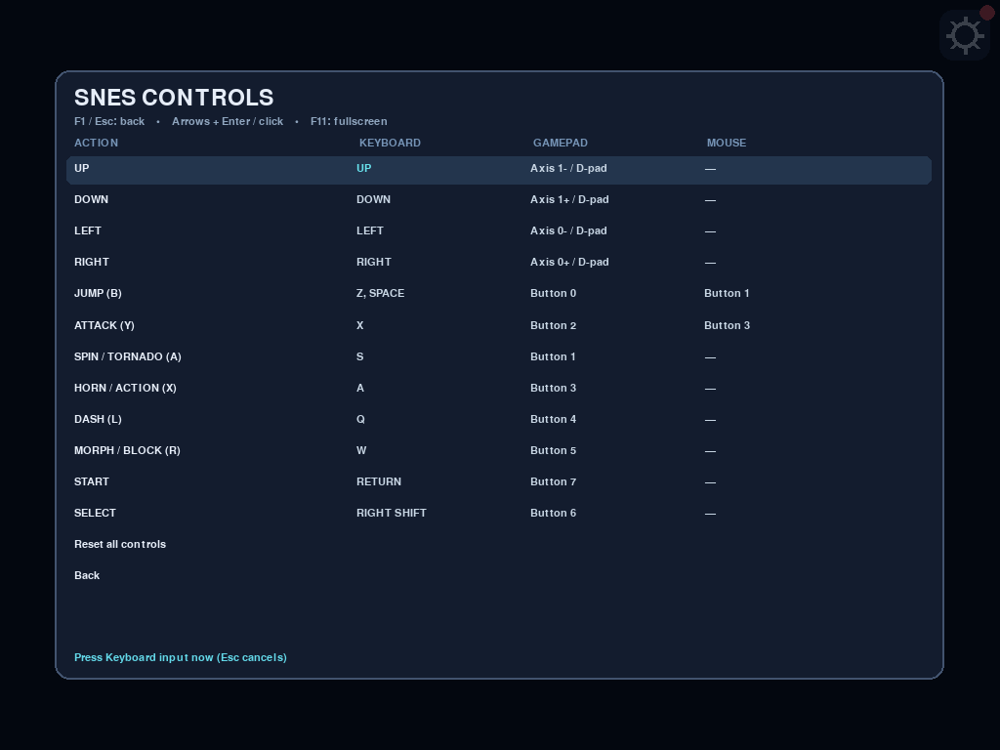
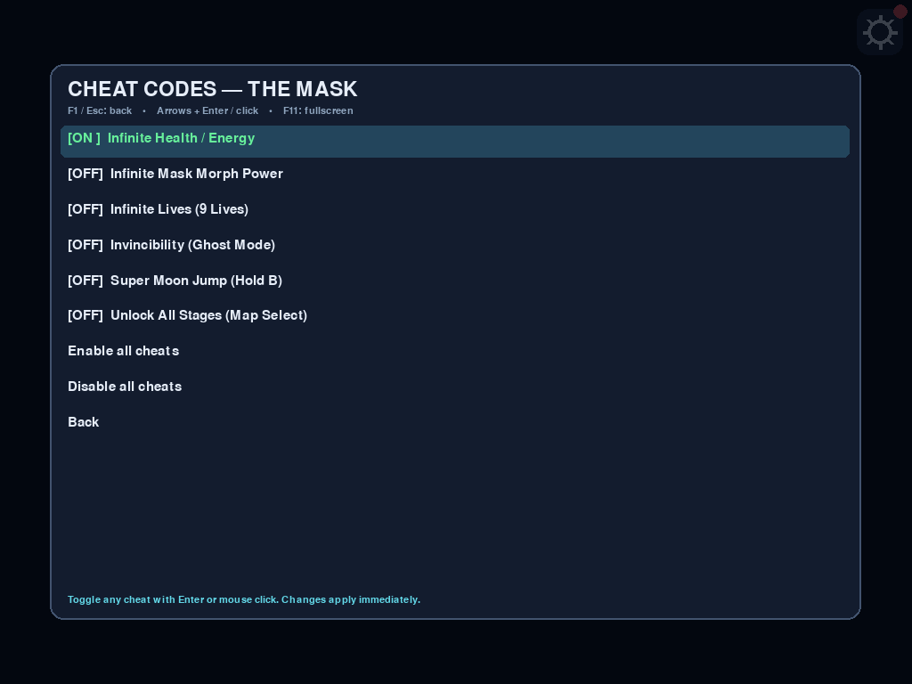

# SNES: The Mask — Desktop (Windows, Linux, macOS)

Portable desktop builds for **The Mask (USA)** powered by the Snes9x 2010 core (`libsnesapp_host`) and `pygame` 2.6.1:

- **Windows x64 Portable EXE:** `The-Mask-Windows-x64.exe` (single-file portable executable with embedded icon `icon.ico`)
- **Linux x86_64 AppImage:** `The-Mask-Linux-x86_64.AppImage` (portable AppImage with embedded `icon.png` and `.desktop` launcher)
- **macOS Apple Silicon App:** `The-Mask-macOS-arm64.zip` (`TheMask.app` bundle with `icon.icns`)

## Features

- **Full 12-button SNES controls:** Remappable across Keyboard, Gamepad (axes, hats, buttons, hotplug), and Mouse.
- **Built-in Cheat Codes Menu (`Cheats`):** Toggle Infinite Health, Infinite Mask Morph Power, Infinite Lives (9), Invincibility (Ghost Mode), Super Moon Jump (Hold B), and Unlock All Stages (Map Select), or enable/disable all cheats at once.
- **About Menu (`About`):** Displays the project description and attribution for **Ahmed Kamal Elgandy**.
- **Display options:** Fill screen (default widescreen) or original 4:3 Fit, Sharp nearest-neighbor or Smooth scaling, `F11` fullscreen toggle.
- **Background Save States:** Automatic background state saving (`autosave.state`) every 5 seconds and on exit via `SaveWorker`, plus manual Save/Load in the `F1`/`Esc`/gear menu.
- **Automatic Update Checks & SHA-256 Verification:** Reads [`updates/desktop/the-mask.json`](../../updates/desktop/the-mask.json) on launch and every 5 minutes, displays an in-game update banner and OS notification when a newer release is available, and verifies file size + SHA-256 digest on download.
