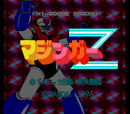

# SNES: Mazinger Z (Android)

A standalone Android app that runs **Mazinger Z** (マジンガーZ / *Makeruna!
Makaroku*, Konami 1993) on the Snes9x 2010 Super Nintendo core.

No external emulator, no browser, no second app: install, launch, play.



This is the SNES sibling of the NES games in this repository. The SNES is a
different machine from the NES — a 65816 CPU with a separate SPC700 audio
processor — so it needs its own core. The app reuses the same shape as the NES
projects: a thin JNI bridge over the libretro API, a native host harness that
runs the very same C code on a desktop, and the shared in-app updater.

## Controls

Landscape, immersive, full screen. The picture is letterboxed to the SNES 4:3
aspect ratio and never cropped.

| Area | Control | What it does |
| --- | --- | --- |
| left | D-pad cross | the eight pad directions; the corners give the diagonals |
| right | **X** / **Y** / **A** / **B** | the four face buttons, in the same diamond as the real pad |
| top left | **L** | left shoulder |
| top right | **R** | right shoulder |
| top middle | **START** / **SELECT** | console buttons |

`A` is the main action (jump), `B` is attack/run, `X` and `Y` are the extra
actions and `L`/`R` are the shoulder buttons.

## How it is built

| Piece | What it is |
| --- | --- |
| `app/src/main/cpp/snes_jni.c` | the JNI bridge: feeds the ROM to `retro_load_game()`, delivers RGB565 video and stereo audio, maps the joypad bitmask |
| `app/src/main/cpp/snes9x2010-src/` | the vendored Snes9x 2010 core (see `THIRD_PARTY_NOTICES.md`) |
| `app/src/main/java/com/midoali/snes/` | the Android layer: activity, emulation thread, video surface and the on-screen pad |
| `tools/host/` | a desktop harness that runs the *same* `snes_jni.c` so the core can be tested without a phone |
| `tools/vpad/` | a pure-JVM test for the control layer |

The core options are pinned in `snes_jni.c`: NTSC region (the cartridge is a
Japanese release), Gaussian audio interpolation, 4:3 aspect and no frame
skipping.

## Build it locally

Requirements: JDK 17+, Android SDK 35, NDK 27.0.12077973, CMake 3.22.1.

```bash
cd games/mazinger-z
chmod +x gradlew
./gradlew :app:assembleDebug
```

The debug APK lands in `app/build/outputs/apk/debug/app-debug.apk`.

## Test the core without a device

The host harness compiles the same `snes_jni.c` on a desktop and drives it from
Python, so the ROM, the core options, the input ids and the audio path can all
be checked on a plain Linux box:

```bash
sudo apt install cmake python3-pil      # or: pip install cmake pillow
cd games/mazinger-z
cmake -S tools/host -B tools/host/build
cmake --build tools/host/build -j 2
python3 tools/host/test_boot.py         # boots the shipped ROM and checks it runs
python3 tools/host/drive.py app/src/main/assets/mazingerz.smc --frames 900 --shot 120
```

`drive.py` writes PNG frames so you can see the title screen, and accepts
`--press START@600` style arguments to hold a button from a given frame.

The control layer has its own test that needs no emulator at all:

```bash
javac -d /tmp/snes-vpad \
    app/src/main/java/com/midoali/snes/{VirtualPad,ScreenMap}.java \
    tools/vpad/VpadTest.java
java -cp /tmp/snes-vpad com.midoali.snes.VpadTest
```

## Saving

The cartridge is a plain ROM with no battery-backed SRAM, so there is nothing
to save. The app still wires the save RAM through the libretro
`RETRO_MEMORY_SAVE_RAM` interface (`sram_load()` / `sram_save()` in
`snes_jni.c`), so a cartridge that does have SRAM will persist its saves in the
app's private files directory.

## Release signing

The release build is signed only when the signing environment is present, so
no key ever lives in the repository:

| Variable | Meaning |
| --- | --- |
| `SNES_KEYSTORE_PATH` | path to the `.jks` keystore |
| `SNES_KEYSTORE_PASSWORD` | keystore password |
| `SNES_KEY_ALIAS` | key alias inside the keystore |
| `SNES_KEY_PASSWORD` | password for that key |

The CI workflow feeds those from the `SNES_SIGNING_KEY_B64`,
`SNES_SIGNING_PASSWORD` and `SNES_SIGNING_ALIAS` repository secrets. Without
them the release APK is produced unsigned and the debug APK is signed with the
standard Android debug key.

Keep a backup of the keystore. Android refuses to install an update whose
signature differs from the installed one, so losing the key means the next
release has to be published under a new package name.

## Legal

The emulator carries no game code of its own. The bundled cartridge image is
© 1993 Konami / © 1993 Bandai and is included for personal use only — see
`THIRD_PARTY_NOTICES.md`. The Snes9x core is used under its non-commercial
licence, so this build is for personal, non-commercial use.
