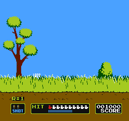

# NES: Mario + Duck Hunt (Android)

[](https://github.com/midoali250/bitvault-engine/actions/workflows/nes-mario-duckhunt.yml)

A standalone Android app that runs **Super Mario Bros. + Duck Hunt** (the
triple multicart ROM, embedded in the APK) on the FCEUmm libretro core.
No external emulator, no browser, no second app: install, launch, play.



## Install

**[⬇ Download NES-Mario-DuckHunt-1.2.apk](https://github.com/midoali250/bitvault-engine/releases/download/nes-mario-duckhunt-v1.2/NES-Mario-DuckHunt-1.2.apk)**

Open the file on the phone (Android 8.0 / API 26 or newer, arm64 or armv7).
All builds: [Releases page](https://github.com/midoali250/bitvault-engine/releases).

## Controls

Landscape, immersive, full screen. The picture is letterboxed to the NES 4:3
aspect ratio and never cropped.

| Area | Control | What it does |
| --- | --- | --- |
| left | free analog stick | NES d-pad, 8 directions, PS-style thumb stick |
| right | **BIG JUMP** | one press performs a full-height jump (A held 22 frames) |
| right | **SMALL JUMP** | repeat: while held, short hops are fired over and over |
| right | **RAPID FIRE** | repeat: B is pulsed while held (fireball after fireball) |
| right | **SINGLE FIRE** | one press = exactly one fireball |
| top middle | **START** / **SELECT** | console buttons |
| play area | any tap | **Zapper shot at that exact pixel** (Duck Hunt) |

### Getting around the cartridge

The ROM is a multicart, so the app boots into its menu:

* **Super Mario Bros.** – press **START** on the menu (opens the SMB title),
  press **START** again to start the 1-player game.
* **Duck Hunt** – push the stick **DOWN** to highlight *DUCK HUNT*, press
  **START**, then **tap “GAME A”** on the title screen with your finger.
  From then on, tapping a duck on screen shoots it, exactly like pointing a
  real Zapper at the TV.

## How it is built

* `app/src/main/cpp/fceumm-src` – FCEUmm core (libretro), unmodified.
* `app/src/main/cpp/nes_jni.c` – small libretro frontend: loads the ROM from
  memory, negotiates RGB565 video, queues audio, feeds the joypad bitmask and
  the light-gun position/trigger, and installs **Player 2 = Zapper** so Duck
  Hunt works while Player 1 stays a normal pad.
* `MainActivity` / `GameView` – `SurfaceView` presentation; the emulator thread
  draws each frame straight onto the surface and is paced by the `AudioTrack`
  write, which keeps NTSC speed and sound in sync.
* `VirtualPad` / `ControlsView` / `Zapper` / `ScreenMap` – the touch layer.
  These classes have no Android imports, so the very same code is compiled and
  unit-tested on a desktop JVM.

```
./gradlew :app:assembleRelease      # signed when NES_KEYSTORE_* env vars are set
./gradlew :app:assembleDebug
```

## Verification

Everything below was run against the code that ships in the APK.

`tools/vpad/VpadTest.java` (runs on a plain JDK, also in CI):

```
directions            6 checks   stick -> d-pad directions, diagonal, dead zone
big jump              2 checks   22-frame A hold, released afterwards
small jump (repeat)   2 checks   6 hops while held, stops on release
rapid fire            1 check    11 B pulses while held
single fire           1 check    exactly one 4-frame shot per press
start / select        3 checks
zapper                9 checks   trigger latch/auto-release, axis mapping, aim()
screen mapping        7 checks   4:3 fit + tap -> NES pixel conversion
ALL TESTS PASSED
```

`tools/host/` builds the same `nes_jni.c` for Linux and drives the real core
(`drive.py`), which produced the screenshots in `docs/shots`:

* multicart menu -> Duck Hunt highlighted -> Duck Hunt title -> **a tap on
  “GAME A” starts round 1** (`duckhunt-round.png`)
* **a tap on a flying duck scores a hit** – score `001000`, two dead ducks in
  the HIT bar (`duckhunt-hit.png`), audio 48 kHz and 60.09 fps with no drops
* START -> SMB title -> START -> World 1-1, stick right walks Mario, BIG JUMP
  lifts him off the ground (`smb-jump.png`)

## Legal

The emulator core is GPLv2 (`fceumm-src`), see `THIRD_PARTY_NOTICES.md`. The
ROM is included because this build exists to play this one cartridge; do not
redistribute it separately from the app.

## Version 1.1 settings

The settings button pauses the game. Optional Mario infinite lives freezes the
player-one lives counter at nine; turn it off for Duck Hunt. Control size and
opacity are adjustable and remembered. The optional full-width mode stretches
the entire picture without cropping; the default keeps the original 4:3 aspect
ratio. Zapper touch mapping follows the selected display mode.

## Version 1.2 Mario protection

Two additional independent settings provide star-style enemy protection and a
bounce rescue near the bottom of pits. Mario's lives, star and pit options are
applied on every emulation frame, including after the game changes levels.
Disable all three before playing Duck Hunt. The timer can still run out; cloud
bonus stages deliberately use a fall to exit, so that exit is not blocked.
Host tests in `tools/host/test_protection.py` exercise 1-1 through 8-4 after
accelerated game transitions, with synthetic fall positions. `tools/host/test_enemy_collision.py 0`
and `2` compare an unprotected and protected enemy encounter in 1-1.

## Project migration

The Mario + Duck Hunt source is maintained in this directory. Generated native build outputs are deliberately excluded.
