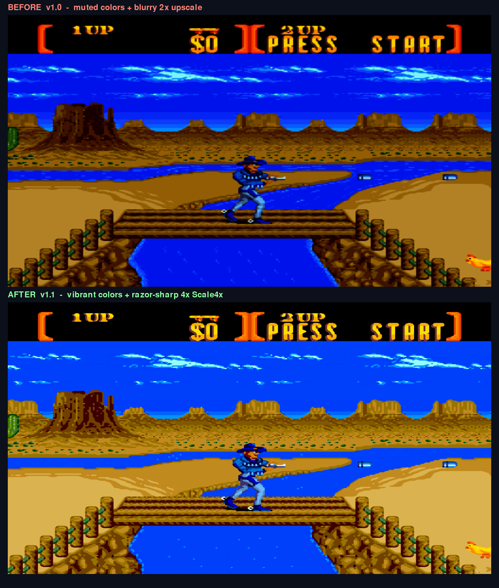

# رعاة البقر — Sunset Riders (Android)

Standalone native Android edition of **رعاة البقر (Sunset Riders)** (`Sunset Riders (U) [!].bin`), powered by the **Genesis Plus GX** libretro C core with **True HD 4x Scale4x + Vibrant Arcade Color LUT + Strict 2D Checkerboard De-Dither + GPU Hardware Filtering**, **60 FPS Crystal-Clear Stereo Audio**, **360° Free-Floating Virtual Joystick**, **Full-Width Mobile Widescreen**, **Reset Game (`🔄 ريست`)**, and **About** dialog inside the Settings menu.

## Highlights

- **App Title**: `رعاة البقر` (`com.midoali.snes.sunsetriders`)
- **True HD Image Quality (جودة الصورة)**:
  - **True HD Crisp (2-stage 4x Scale4x + Strict 2D Checkerboard De-Dither + Vibrant Arcade Color LUT)** enabled by default (`1024x896` / `1280x896` zero-copy `RGB_565` output rendered via `SurfaceHolder.lockHardwareCanvas()` GPU pipeline).
  - Switchable in **Settings → Image Quality**:
    1. **True HD Crisp (4x Scale4x + Vibrant Colors + GPU Filter)** — *Default*
    2. **Ultra Smooth (4x Bilinear + Vibrant Colors)**
    3. **Raw Pixel (1x Sharp)**
- **Ultra-Lightweight 60 FPS Performance & Clear Audio**:
  - `YM2612_ENHANCED` FM synthesis with low-overhead native mixing (`hq_fm = 0`, `hq_psg = 0`, `-O3 -funroll-loops`) and 1472-frame audio pre-roll cushioning for zero crackling or lag.
- **Reset Game Button (`🔄 ريست` / `Reset Game`)**:
  - Available directly in the top control bar (`🔄 ريست`) and inside **Settings (`⚙️ الضبط`)**.
- **Full-Width Mobile Widescreen**:
  - Defaults to **Fill Screen (Full Mobile Width)** (`fillScreen = true`), with toggle in **Settings → Screen Size**.
- **360° Free-Floating Analog Virtual Stick**:
  - Defaults to **Free-Floating Stick (360°)** (`dpadFreeMode = true`) on the left side of the screen.
- **About Dialog (inside Settings & Top Bar)**:
  > This application has been developed by **Ahmed Kamal Elgandy** to serve as a digital archive and platform for running and optimizing classic retro and Atari-style games on mobile devices. The project aims to revive memories and preserve the software heritage of classic games with a smooth, lightweight experience, while fully respecting the intellectual property rights of the original production companies.

## مقارنة جودة الصورة (v1.0 → v1.1)

- **قبل (v1.0)**: ألوان مطفية/غامقة لأن الـ LUT كان يطرح 8 من كل قناة فوق نطاق DAC (0..238)، وصورة معمّية بسبب الخلط الأفقي 50/50 وHQ2x ثم تكبير 3.75× على 1080p.
- **بعد (v1.1)**: ألوان زاهية مشبعة (توسيع كامل للنطاق + Bright Arcade Gamma 0.68 + Hue-Preserving Vibrance) وصورة حادة تمامًا (Strict 2D Checkerboard De-Dither + Scale4x نقي بدقة `1024×896` ثم تكبير ~1.2× فقط).
