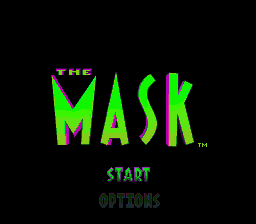
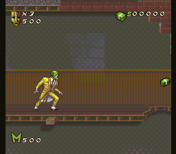

# SNES: The Mask (Android & Desktop)

A standalone multi-platform build of **The Mask** (*The Mask*, Black Pearl Software / THQ 1995, USA LoROM `AMGE`, CRC32 `E17626E2`) running on the Snes9x 2010 Super Nintendo core.

  

## Supported Platforms & Releases

| Platform | Package | Update Manifest | Archive Folder |
| --- | --- | --- | --- |
| **Android (8.0+)** | [`The-Mask-SNES-1.0.apk`](https://github.com/midoali250/bitvault-engine/releases/download/the-mask-v1.0/The-Mask-SNES-1.0.apk) | [`updates/games/the-mask.json`](../../updates/games/the-mask.json) | [`RELEASE-ARCHIVE/Android/The-Mask/1.0/`](../../RELEASE-ARCHIVE/Android/The-Mask/) |
| **Windows x64 (Portable EXE)** | [`The-Mask-Windows-x64.exe`](https://github.com/midoali250/bitvault-engine/releases/download/the-mask-desktop-v1.0.0/The-Mask-Windows-x64.exe) | [`updates/desktop/the-mask.json`](../../updates/desktop/the-mask.json) | [`RELEASE-ARCHIVE/Windows/The-Mask/1.0.0/`](../../RELEASE-ARCHIVE/Windows/The-Mask/) |
| **Linux x86_64 (AppImage)** | [`The-Mask-Linux-x86_64.AppImage`](https://github.com/midoali250/bitvault-engine/releases/download/the-mask-desktop-v1.0.0/The-Mask-Linux-x86_64.AppImage) | [`updates/desktop/the-mask.json`](../../updates/desktop/the-mask.json) | [`RELEASE-ARCHIVE/Linux/The-Mask/1.0.0/`](../../RELEASE-ARCHIVE/Linux/The-Mask/) |
| **macOS Apple Silicon (App ZIP)** | [`The-Mask-macOS-arm64.zip`](https://github.com/midoali250/bitvault-engine/releases/download/the-mask-desktop-v1.0.0/The-Mask-macOS-arm64.zip) | [`updates/desktop/the-mask.json`](../../updates/desktop/the-mask.json) | [`RELEASE-ARCHIVE/macOS/The-Mask/1.0.0/`](../../RELEASE-ARCHIVE/macOS/The-Mask/) |

## Key Features

- **Full-Width Mobile Widescreen (`شاشة عريضة بعرض شاشة الموبايل`):** Enabled by default on Android (`GameView.stretch = true`) so the picture spans the full width of modern widescreen mobile displays, with a toggle in the Menu.
- **Free-Floating 360° Virtual Analog Stick (`عصاية تحكم حرة`):** Touching anywhere on the left side of the Android screen anchors the floating virtual joystick under your thumb and follows 360° movement smoothly across all 8 SNES directions.
- **Built-in Cheat Codes Menu (`قائمة أكواد الغش`):** Available in both the Android Menu (`🎮 الغش`) and the Desktop Pause Menu (`Cheats`):
  1. **Infinite Health / Energy (`طاقة وصحة لا نهائية`)** — `7E0110=01` + `7E18AF..7E18B0=0500`
  2. **Infinite Mask Morph Power (`قوة القناع والأسلحة لا نهائية`)** — `7E0112=01` + `7E008F..7E0090=0500`
  3. **Infinite Lives (`أرواح لا نهائية - 9 أرواح`)** — `7E010E=01` + `7E0095=09`
  4. **Invincibility / Ghost Mode (`عدم التضرر واختراق الأعداء`)** — `7E18B9=46`
  5. **Super Moon Jump (`قفزة خارقة / طيران عند الضغط على B`)** — upward velocity boost while holding `B`
  6. **Unlock All Stages (`فتح جميع المراحل في الخريطة`)** — `7E0114=01`
  - Plus custom Game Genie (`XXXX-XXXX`) and Pro Action Replay (`7EXXXXYY`) code input on Android.
- **About Dialog (`About`):** Dedicated `About` button in the menu displaying the developer attribution for **Ahmed Kamal Elgandy**.

## Controls

| Button | Android Touch | Desktop Keyboard Default | Action in *The Mask* |
| --- | --- | --- | --- |
| Stick / D-Pad | Left 360° free-floating virtual joystick | Arrow keys | Move / crouch / aim |
| **B** | Bottom face button | `Z` / `Space` | Jump (or Moon Jump when cheat is active) |
| **Y** | Left face button | `X` | Punch / basic attack |
| **A** | Right face button | `S` | Tornado spin |
| **X** | Top face button | `A` | Special weapon / giant mallet / horn |
| **L** | Top-left shoulder | `Q` | Dash / cycle weapon |
| **R** | Top-right shoulder | `W` | Block / stealth morph |
| **START** | Top-center button | `Enter` | Start / pause |
| **SELECT** | Top-center button | `Right Shift` | Select |

## About

This application has been developed by **Ahmed Kamal Elgandy** to serve as a digital archive and platform for running and optimizing classic retro and Atari-style games on mobile devices. The project aims to revive memories and preserve the software heritage of classic games with a smooth, lightweight experience, while fully respecting the intellectual property rights of the original production companies.
